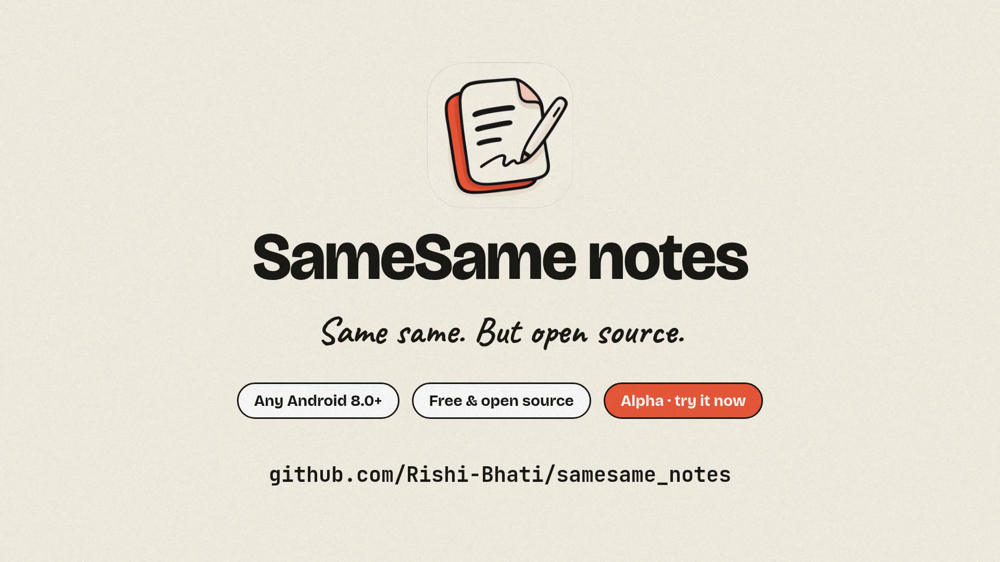
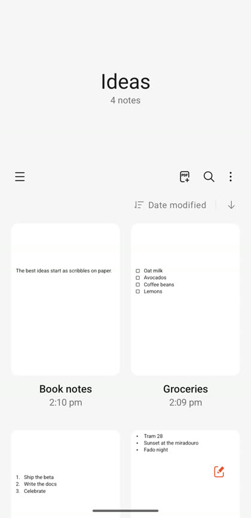
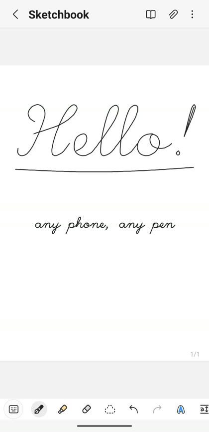
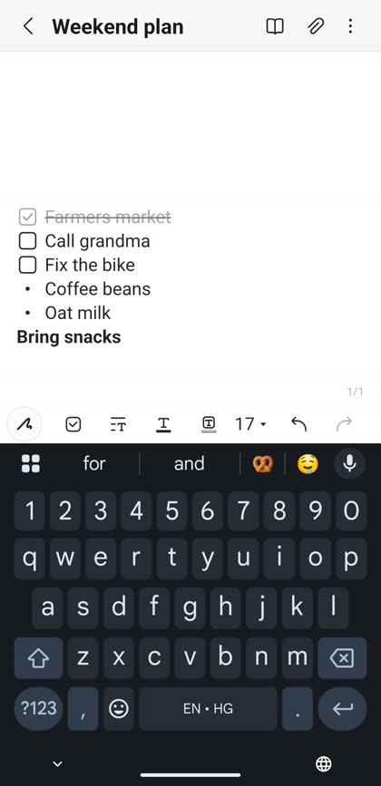
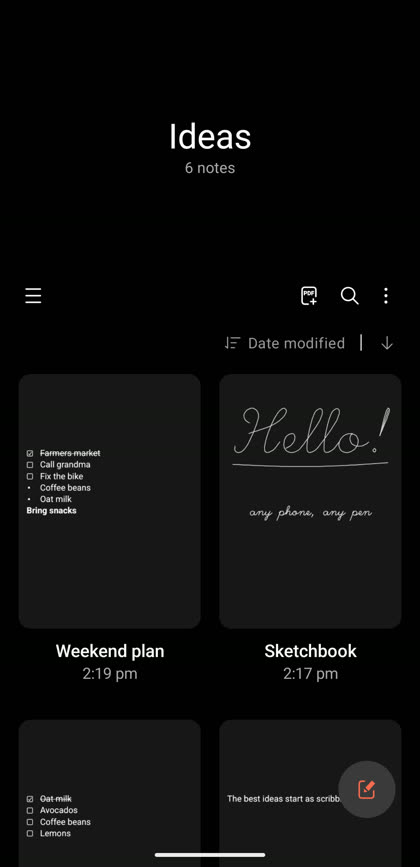

<p align="center">
  
</p>

[](https://reportary.onrender.com/p/KpEraP6diT5xj5xzvnJzZ23Zob2lSvfm8LKBM1RhEyJkCIplAZx_Dqc3uCeuJw9V/)


# SameSame notes

**Same same. But open source.**

> **Alpha.** SameSame notes 0.2.0-alpha is an early release for testing. Expect bugs and rough edges, and expect
> file formats and behaviour to change before a stable release.
> Please [report issues](https://reportary.onrender.com/p/KpEraP6diT5xj5xzvnJzZ23Zob2lSvfm8LKBM1RhEyJkCIplAZx_Dqc3uCeuJw9V/) when you find them.

## Overview

SameSame notes is an open-source notes app for Android with handwriting. It aims for familiar screens, toolbar
layout, menus and gestures, so people who already use a stylus notes app should find their way around quickly.
It is more open in one respect: each note is a single ZIP file made of JSON and binary ink layers, and all of
it stays on the device. The app declares no INTERNET permission.

Notes can be exported to PDF, images, plain text, Markdown, HTML, Word and PowerPoint. Samsung Notes `.sdocx`
files can be imported and exported.

SameSame notes is not affiliated with, endorsed by or sponsored by Samsung Electronics. See
[Acknowledgements and legal](#acknowledgements-and-legal).

## Status at a glance

| Item | Status |
|---|---|
| Version | 0.2.0-alpha |
| Stage | Alpha. Expect bugs. Formats and behaviour may change. |
| Platform | Android 8.0 (API 26) and newer. Designed phone first; tablet and large-screen layouts are not yet polished. |
| Language | English only |
| Data | Stored on the device only. No INTERNET permission. |
| Note format | `.ssnote`, versioned. Older notes are migrated when opened. |
| Samsung Notes files | `.sdocx` import and export |
| Cloud sync and backup | Not built yet (see the roadmap) |
| Licence | MIT OR Apache-2.0, at your option |
| Downloads | Released alpha builds are on the [GitHub Releases](https://github.com/Rishi-Bhati/samesame_notes/releases) page. |

## Preview

[](branding/promo/SameSame-notes-promo.mp4)

<p align="center"><sub>Click the preview to watch the full 45-second video.</sub></p>

<p align="center">
  
  
  
  
</p>

## Features

Features are grouped by area. Anything not listed here is not built yet.

### Handwriting and drawing

- Pens with colour and size settings, a highlighter, and an eraser with stroke and area modes.
- Favourite pens (up to 45), recently used colours, a colour palette and an eyedropper for picking colours.
- Lasso selection to move and transform strokes and objects.
- Straighten a stroke that was meant to be a straight line.
- An easy writing pad for neatly aligned handwriting.
- Low-latency stroke rendering with AndroidX Ink, for stylus and finger input.
- Pinch to zoom the page, and pinch and twist to scale and rotate a selected object.
- Ink adapts to dark pages.

### Text

- Rich text body with bold, italic, strikethrough, headings, font sizes and colours.
- Bulleted, numbered and checklist items, with indentation. Checked items are struck through.
- Typing shortcuts: `- ` or `* ` starts a bullet list, `1. ` a numbered list, `[] ` a checklist, and `*bold*`,
  `_italic_` and `~strike~` format text as you type.
- Web addresses, e-mail addresses, phone numbers and dates or times are detected and shown as links.
- Undo and redo (up to 200 steps), and autosave while you write.

### Objects and images

- Text boxes, images and drawings can be placed on the page. Move them, resize and rotate them with handles, or
  use pinch and twist.
- Images can be cropped with a rectangle or a lasso, opened in another app for editing, shared, or saved.
- Layering: bring to front, send to back, and move forward or backward.
- Take a photo with the in-app camera and insert it on the page.
- Anchor an image or drawing to the text, so it moves with the text.

### Pages and reading

- Page templates and page settings. Each page can have its own size, and PDF imports keep each page's size.
- A page sorter for reordering pages. Pull up past the last page to add a new one.
- Reading mode for reviewing a note without editing it. Tap text to start editing at that point.
- Search inside a note, with results you can step through.

### Voice recordings

- Record voice recordings inside a note and play them back from a recording bar.
- A recordings list to rename, share and delete recordings.

### Files

- A Files library opened from the side panel: import any file type as a local copy (nothing is uploaded), organise
  files in folders, grid or list view, sort, search, rename, move, share, and a Recycle bin for deleted files.
- Built-in viewers for images, PDFs (read-only), text files and audio, and a Storage page showing what the files use.
- SameSame notes appears in Share and Open with for every file type. Files that can't go into a note are saved to
  Files.
- Copy a file's link and paste it into a note: pictures can be shown in the note or kept as a link, other files paste
  as a link. Tapping a link opens the file, and a file's Info lists the notes that use it. Insert > From Files adds
  links from the editor.
- Exports keep file links, and a `.ssnote` file can include the files its notes link to.

### Folders, search and trash

- Nested folders (up to 50 levels deep), grid or list view, sorting, favourites and multi-select.
- Full-text search over note titles and text.
- Fast scrolling for long lists.
- Deleted notes stay in the trash for 30 days before they are removed.

### Locking

- Lock individual notes with a password of at least 6 characters, with optional biometric unlock.
- After five wrong passwords, unlocking waits 30 seconds, and the wait doubles after each further failure.
- Locked notes relock shortly after the app goes to the background.
- Screenshots and screen recordings are blocked while a locked note is open.
- Locked notes are never included in bulk export.

### Import and export

- Save as file in these formats: `.ssnote`, `.sdocx`, PDF, PNG or JPEG images (one file per page, or one tall
  image), plain text, Markdown, HTML, Word (`.docx`) and PowerPoint (`.pptx`).
- Open or share `.ssnote`, `.sdocx` and PDF files from other apps. Each file is imported as a note, and each PDF
  page becomes a note page with its own size.
- Several files shared at once are each imported as their own note.
- Samsung Notes `.sdocx` files import with their handwriting, text and styles, voice recordings and pictures, and
  export back with edits to strokes and text. Export is new and experimental: see the limitations below.
- Bulk import and export (Settings, General): import several files at once, or export selected notes in one
  format to a folder.

### Appearance

- Light, dark and system themes.

### Performance

- Work to keep the editor and home screen smooth on low-end devices: editor page text is cached, unchanged
  content is not redrawn on every frame, and fewer note previews are rendered on devices with few CPU cores.

## Known limitations (alpha)

- Expect bugs and rough edges, particularly in recently added features.
- File formats may change. Notes are versioned: older notes are migrated when opened, and a note written by a
  newer version is refused by an older app.
- `.sdocx` export is experimental. Pages added or removed in an imported note, and objects placed on its pages, are
  not written back; in notes made here, floating pictures lose their position, floating text boxes become paragraphs,
  and templates, PDF backgrounds, pressure and tilt are not written. Legacy `.sdoc` files are not supported.
- Word (`.docx`) and PowerPoint (`.pptx`) exports are new and may not look right in every viewer.
- PDF pages are imported as images, so their text cannot be selected or searched. PDF export writes original
  pages as images, and the text layout of native notes in PDF export can differ slightly from the editor.
- Ink is not searchable. There is no handwriting recognition yet. Home search matches whole words and word starts
  in titles and in typed body text; text-box content and default titles are not searchable yet.
- There is no cloud sync and no in-app backup. Locked notes restored from an Android backup cannot be opened,
  because their keys are not backed up.
- Voice recording and playback are still being validated on more devices.
- Layouts are designed phone first. Tablet and large-screen layouts are not polished.
- English only. Accessibility has not been reviewed.
- Performance on low-end devices is still being measured.
- Alpha builds are not signed for a store and there is no store listing yet.

## Roadmap and future plans

Everything in this section is planned, not built. The items are in rough order.

- Sync with Google Drive, with conflict handling. Other cloud services later, if feasible. (Planned, not built.)
- Backup and restore, to Google Drive and to a folder on the device. (Planned, not built.)
- Handwriting recognition: convert ink to text, and make ink searchable. (Planned, not built.)
- Markdown preview with full CommonMark and GFM support. (Planned, not built.)
- A PDF reader and annotation mode, with selectable text. (Planned, not built.)
- Voice playback that replays ink in sync with the recording. (Planned, not built.)
- Complete `.sdocx` export: page changes, floating objects, templates, pressure and tilt. (Planned, not built.)
- Finish device validation of voice recording and playback. (Planned, not built.)
- Tablet and large-screen layout polish. (Planned, not built.)
- Localisation into other languages. (Planned, not built.)
- Accessibility review and fixes. (Planned, not built.)
- Release signing and distribution beyond GitHub, such as an F-Droid style catalogue. (Planned, not built.)

## Download and install

Alpha builds are published on the
[GitHub Releases](https://github.com/Rishi-Bhati/samesame_notes/releases) page. 0.1.0-alpha, 0.1.1-alpha and 0.2.0-alpha
are available there. Only install alpha builds from this repository's Releases page. Android asks you to allow
installing from an unknown source the first time.

Installing a new build over an old one keeps your notes and settings. To build the app from source, see below.

## Getting started

### Requirements

- JDK 21. Newer JDKs are not supported by the Android Gradle Plugin used here.
- Android SDK with platform 37.
- An Android device or emulator running Android 8.0 (API 26) or newer.

### Build and run

```bash
git clone https://github.com/Rishi-Bhati/samesame_notes.git
cd samesame_notes

# Point the build at your SDK (Android Studio writes this file for you; or set ANDROID_HOME)
echo "sdk.dir=/path/to/Android/Sdk" > local.properties

./gradlew assembleDebug      # build the debug APK
./gradlew installDebug       # install on a connected device or emulator
```

Gradle must run on JDK 21. Set `org.gradle.java.home` in `~/.gradle/gradle.properties`, or set `JAVA_HOME`.

The debug build installs as `org.samesame.notes.debug`, so it can sit beside a release build.
In Android Studio, open the project folder; the wrapper and `local.properties` are picked up automatically.

### Tests

```bash
./gradlew testDebugUnitTest :core:model:test   # JVM unit tests
./gradlew connectedDebugAndroidTest            # instrumented tests (needs a device or emulator)
./gradlew lint                                 # Android lint
```

Ink strokes and brushes use a native library, so tests that create them must be instrumented tests.

### Dependencies

Dependency verification is strict: Gradle checks every downloaded artifact against
`gradle/verification-metadata.xml`. After you add or change a dependency, regenerate the metadata for the tasks
you run, for example `./gradlew --write-verification-metadata sha256 testDebugUnitTest`, and commit the updated
file.

## Tech stack

| Area | Choice |
|---|---|
| Language and UI | Kotlin 2.4.21, Jetpack Compose with Material 3, Navigation 3 |
| Ink | AndroidX Ink 1.1.0-alpha09: front-buffered strokes, motion prediction, custom brushes |
| Storage | Room 2.8.5 on bundled SQLite (catalog and FTS4 search index); one `.ssnote` file per note |
| Camera | CameraX 1.6.2 for the in-app camera |
| Locking | PBKDF2-HMAC-SHA256 key wrapping and AES-GCM, with optional biometrics backed by an Android Keystore key |
| Dependency injection | Hilt (KSP) |
| Build | Gradle 9.8.1 wrapper, Android Gradle Plugin 9.4.1 with built-in Kotlin, convention plugins in `build-logic/` |
| Platform | minSdk 26 (Android 8.0), compile and target SDK 37 |

## Project structure

```
app                  Application, activities, navigation graph
core/model           Domain types and product limits (pure Kotlin, JVM tests)
core/designsystem    Theme, colours, icons and shared components
core/database        Room catalog: notes, nested folders, tags, FTS search index
core/document        Note bundle format (.ssnote) and the atomic file store
core/ink             Pen catalog, brushes, stroke codec, erasers, lasso and transforms
core/richtext        Rich text engine: lists, checklists, pagination, selection, IME
core/export          Export to PDF, images, text, Markdown, HTML, DOCX and PPTX
core/sdocx           Samsung Notes .sdocx reader, writer and mapper
core/security        Lock vault and cryptography
core/data            Repositories, import and export services, preferences
feature/notes        Home screens: notes list and grid, drawer, folders, trash, search
feature/composer     Note editor: canvas, toolbars, panels, undo and redo, autosave
feature/settings     Settings screens, including bulk import and export
feature/lock         Lock and unlock screens and biometric flows
feature/share        Share sheet, save-as-file dialog and transfer progress
feature/camera       In-app camera sheet for inserting photos
```

## Architecture notes

- Feature modules reach storage through repositories in `core:data`. They do not use the Room DAOs or the note
  file store directly.
- Room is the catalog and search index. Note content lives in one `.ssnote` file per note. The editor works on a
  working copy and packs it back into the `.ssnote` file on save, writing pages before `document.json`.
- A change to the note document or the stroke codec needs a format version bump and a reader for older versions.
  A Room schema change needs a migration, and the exported schema JSON is committed under `core/database/schemas/`.
- Product limits (trash retention, folder depth, toolbar size and others) are defined in `core/model/Limits.kt`.
- Pen families are stored on disk by the key in `BrushFamily.developerComment`. Keep that key when retuning a brush.

## File formats

- **`.ssnote`** (native): a ZIP container with `manifest.json`, `document.json` (text, pages, objects and
  recordings), `ink/` (one binary stroke layer per page) and `media/` (images and recordings).
- **`.sdocx`** (Samsung Notes): read and written by `core:sdocx`. Imported notes keep their original archive, so
  an unedited note exports back unchanged, and edited notes are written with the same structure as the original app's files.
- **Legacy `.sdoc`**: not supported.

## Reporting issues

Use the **Report issues** button at the top of this page. Helpful reports include:

- your device model and Android version;
- the app version (Settings, About);
- what you did, what you expected, and what happened.

Please do not attach personal notes. If a note is needed to reproduce a problem, make a dummy note with the same
structure.

## Contributing

Contributions are welcome. See [CONTRIBUTING.md](CONTRIBUTING.md) for the module rules, code style and tests.

- Read the architecture notes above, and keep features behind repositories in `core:data`.
- Run `./gradlew testDebugUnitTest :core:model:test` before opening a pull request.
- Do not submit code, resources, strings or artwork copied from Samsung's apps. Describe observed behaviour instead.

## Security

Please report vulnerabilities privately: open the repository's **Security** tab and choose
**Report a vulnerability**. Do not open a public issue for a security problem. The security model and supported
versions are described in [SECURITY.md](SECURITY.md).

## License

SameSame notes is dual-licensed under either of

- the MIT License ([LICENSE-MIT](LICENSE-MIT)), or
- the Apache License, Version 2.0 ([LICENSE-APACHE](LICENSE-APACHE)),

at your option. Unless you state otherwise, any contribution you submit for inclusion in this project is
dual-licensed as above, without any additional terms or conditions. See also [NOTICE](NOTICE) and
[ATTRIBUTION.md](ATTRIBUTION.md), which explains where the UI icons come from.

## Acknowledgements and legal

SameSame notes is an independent project. It is not affiliated with, endorsed by or sponsored by Samsung
Electronics. "Samsung" and "Samsung Notes" are trademarks of their owner and are used here only to describe
compatibility.

The app's code and artwork are written for this project, and the project does not include Samsung source code.
Its UI icons come from the [OneUI icon library](https://github.com/OneUIProject/oneui-icons), whose icons were
taken from Samsung's apps. Open-source components are listed in Settings, About, Licences.

Built with AndroidX (including AndroidX Ink), Jetpack Compose, Room and Hilt.
